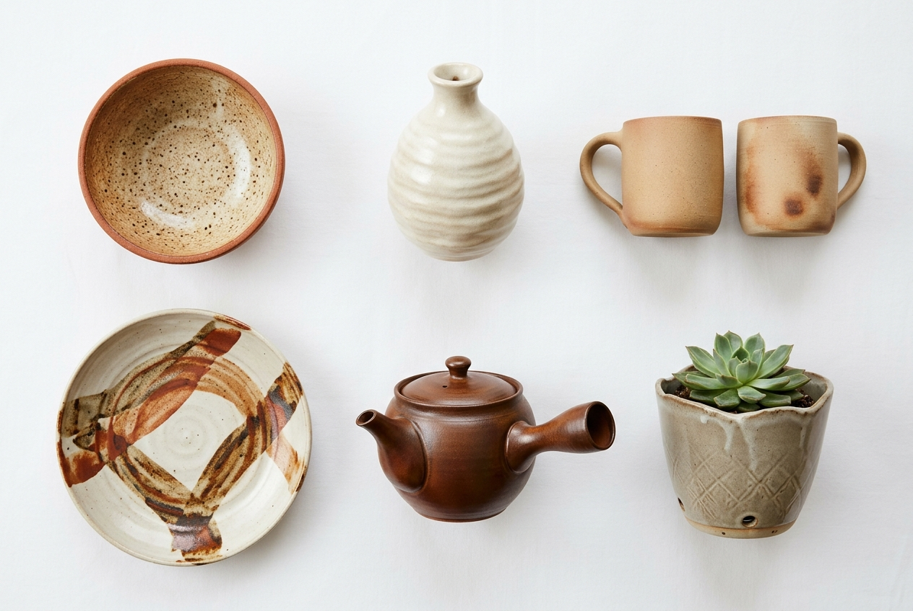

# 🏺 Clayé Ceramic — Artisan Stoneware E-Commerce

Website e-commerce modern untuk studio keramik artisanal **Clayé**, dibangun menggunakan **React.js 18** dan **Vite**.



---

## ✨ Fitur Utama

1. **🏠 Homepage Showcase**
   - Hero banner interaktif dengan filosofi studio keramik.
   - Pilihan produk terlaris & testimoni pembeli.
   - Pendaftaran newsletter dengan kupon diskon instan.

2. **🏺 Katalog Produk Dinamis**
   - Filter kategori (Mangkuk, Vas, Mug, Piring, Teko, Pot).
   - Pencarian real-time berdasarkan nama produk atau deskripsi.
   - Sorting harga (termurah/termahal), rating, dan kategori populer.

3. **🔍 Detail Produk Lengkap**
   - Galeri foto resolusi tinggi karya keramik.
   - Informasi spesifikasi teknis (material, dimensi, berat, food-grade).
   - Pilihan jumlah kuantitas, tombol *Tambah ke Keranjang* & *Beli Sekarang*.
   - Tab deskripsi, spesifikasi, dan panduan pengemasan garansi anti-pecah.

4. **🛒 Keranjang Belanja & Kupon Diskon**
   - Tambah, ubah kuantitas, atau hapus item.
   - Validasi kode kupon promo (`CLAYE10` untuk diskon 10%, `HEMAT20` untuk 20%).
   - Ringkasan kalkulasi subtotal dan diskon otomatis.

5. **💳 Checkout Terpadu**
   - Formulir multi-step data penerima.
   - Pilihan kurir pengiriman (JNE Express Woodpack, SiCepat Cargo, GoSend).
   - Metode pembayaran (BCA VA, Mandiri VA, QRIS instan, Kartu Kredit).
   - Konfirmasi pesanan dengan pembuatan nomor invoice digital.

6. **🔐 Autentikasi Pengguna**
   - Form Masuk & Pendaftaran akun baru.
   - Fitur *Quick Demo Fill* 1-klik untuk testing cepat.
   - Login sosial Google & Apple ID.

7. **👤 Dashboard Pelanggan**
   - Pelacakan status pesanan & nomor resi pengiriman.
   - Tampilan poin reward loyalitas member.
   - Pengelolaan profil dan buku alamat pengiriman.

8. **⚡ Dashboard Admin**
   - Metrik KPI omzet penjualan, jumlah pesanan, dan total produk aktif.
   - Pembaruan status pesanan masuk.
   - Form pembuatan dan penerbitan produk baru secara langsung.

---

## 🛠️ Teknologi yang Digunakan

- **React 18**: Komponen UI deklaratif dan reaktif.
- **Vite 5**: Bundler super cepat dengan Hot Module Replacement (HMR).
- **React Context API**: Manajemen state global (Cart, Auth, Orders, Products, Toasts).
- **Vanilla CSS**: Desain kustom berestetika earthy warm luxury tanpa ketergantungan library luar.
- **LocalStorage**: Penyimpanan data persisten pada browser pengguna.

---

## 🚀 Cara Menjalankan Project

1. **Clone repository ini**:
   ```bash
   git clone https://github.com/AlyaAdhetya/claye-ecommerce.git
   cd claye-ecommerce
   ```

2. **Install dependensi**:
   ```bash
   npm install
   ```

3. **Jalankan development server**:
   ```bash
   npm run dev
   ```

4. Buka browser di [http://localhost:3000](http://localhost:3000).

---

## 📦 Build untuk Produksi

```bash
npm run build
npm run preview
```

---

Dibuat untuk Praktikum E-Commerce — © 2026 Clayé Ceramic Studio.
