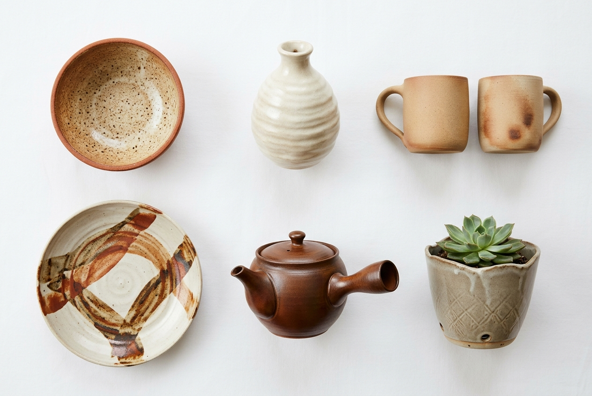

# 🏺 Clayé Ceramic — Curated Stoneware & Reseller E-Commerce

Website e-commerce modern untuk platform kurasi dan reseller keramik & stoneware Nusantara **Clayé**, dibangun menggunakan **React.js 18** dan **Vite**.



---

## 📌 Model Bisnis & Konsep Produk
Project ini mengadopsi model **Curated Store & Reseller**:
- Produk keramik **bukan diproduksi sendiri**, melainkan diseleksi dan diambil langsung dari berbagai studio tembikar independen serta sentra pengrajin lokal berbakat di Indonesia (seperti Kasongan Yogyakarta, Sukabumi, Bandung, dan Bali).
- Seluruh produk melalui pemeriksaan mutu (*Quality Control*) ketat untuk memastikan material stoneware kokoh, lapisan glasir 100% aman untuk makanan (*food-safe*, bebas timbal), serta estetika *wabi-sabi* berkarakter otentik.
- Produk disimpan di gudang pusat CLAYÉ, dikemas dengan proteksi berlapis ramah lingkungan (*eco honeycomb wrap*), dan didistribusikan ke pelanggan dengan garansi 100% anti-pecah.

---

## ✨ Fitur Utama

1. **🏠 Homepage Curated Showcase**
   - Hero banner kurasi keramik estetik pilihan untuk keseharian.
   - Pilihan koleksi kurasi unggulan & komitmen kurasi transparan.
   - Akses cepat konsultasi produk via concierge virtual.

2. **🏺 Katalog Produk Terkurasi**
   - Filter kategori (Mangkuk, Vas, Cangkir & Mug, Peralatan Makan, Kopi & Teh, Pot Tanaman).
   - Pencarian real-time berdasarkan nama produk atau deskripsi.
   - Pengurutan harga, rating, dan popularitas produk.

3. **🔍 Detail Produk Lengkap & Provenansi**
   - Galeri foto multi-sudut dan detail warna glasir.
   - Informasi provenansi (asal mitra pengrajin, dimensi, berat, food-safe, teknik tembikar).
   - Pilihan varian warna glasir dan opsi personalisasi grafir nama/inisial via pengrajin.
   - Accordion spesifikasi teknis, panduan perawatan, dan garansi pengiriman aman.

4. **🛒 Keranjang Belanja & Kupon Promo**
   - Tambah, ubah kuantitas, atau hapus item.
   - Validasi kode kupon promo (`CLAYE10` untuk diskon 10%).
   - Ringkasan kalkulasi subtotal dan garansi proteksi kemasan gratis.

5. **💳 Checkout Terpadu**
   - Formulir multi-step data penerima dan alamat pengiriman.
   - Pilihan kurir pengiriman (Pengiriman Standar & Pengiriman Kilat Prioritas).
   - Metode pembayaran terintegrasi (Transfer Bank BCA Manual, QRIS Instan, Virtual Account).
   - Konfirmasi pesanan dan pembuatan resi tracking digital.

6. **💬 Asisten Kurasi Chatbot AI**
   - Konsultasi pemilihan cangkir/mug untuk kopi, mangkuk saji, dan vas bunga.
   - Panduan instan perawatan stoneware & penggunaan microwave/dishwasher.
   - Penjelasan transparansi model kurasi dan kemitraan pengrajin.

7. **👤 Dashboard Pelanggan & Profil Admin**
   - Pelacakan status pesanan real-time & arsip riwayat transaksi.
   - Panduan perawatan keramik interaktif.
   - Manajemen buku alamat pengiriman pelanggan & data profil pengelola.

8. **⚡ Dashboard Manajemen Admin**
   - Metrik KPI omzet penjualan, total pesanan, dan inventaris produk aktif.
   - Manajemen katalog (tambah, edit, hapus produk kurasi, sinkronisasi stok gudang).
   - Monitoring pemrosesan pesanan dan status pengiriman.

---

## 🛠️ Teknologi yang Digunakan

- **React 18**: Komponen UI deklaratif dan reaktif.
- **Vite 5**: Bundler super cepat dengan Hot Module Replacement (HMR).
- **React Context API**: Manajemen state global (Cart, Auth, Orders, Products, Toasts, Route).
- **Vanilla CSS**: Desain kustom berestetika *earthy warm luxury* tanpa ketergantungan library eksternal.
- **LocalStorage**: Penyimpanan data persisten pada browser pengguna.

---

## 🚀 Cara Menjalankan Project

1. **Install dependensi**:
   ```bash
   npm install
   ```

2. **Jalankan development server**:
   ```bash
   npm run dev
   ```

3. Buka browser di [http://localhost:5173](http://localhost:5173) (atau port yang tertera di terminal).

---

## 📦 Build untuk Produksi

```bash
npm run build
npm run preview
```

---

Dibuat untuk Praktikum E-Commerce — © 2026 Clayé Curated Ceramics.
